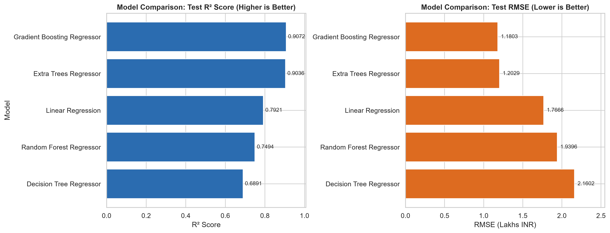
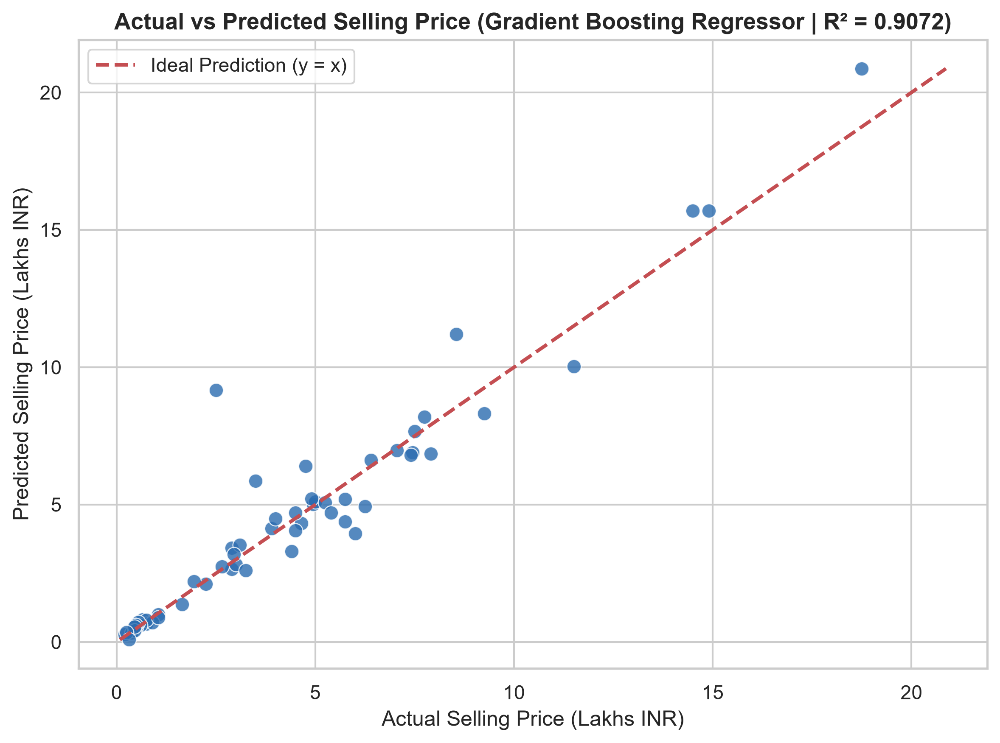
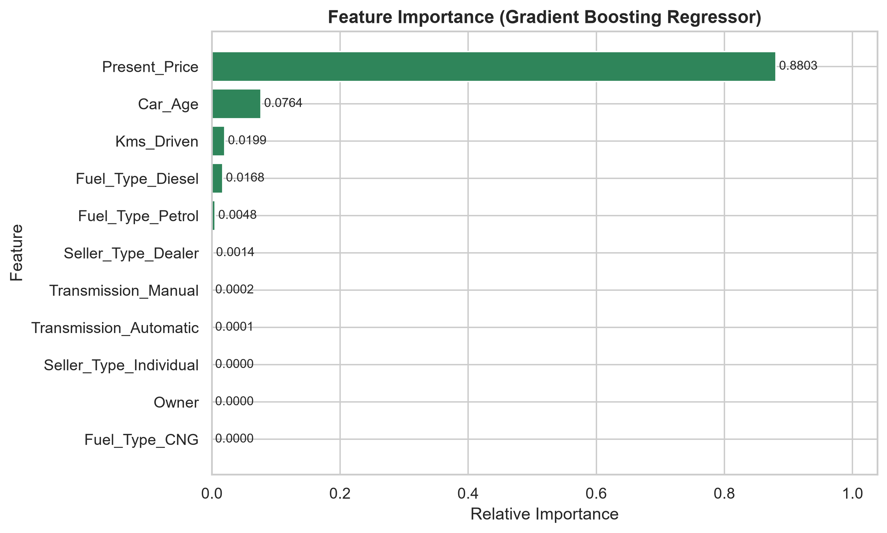
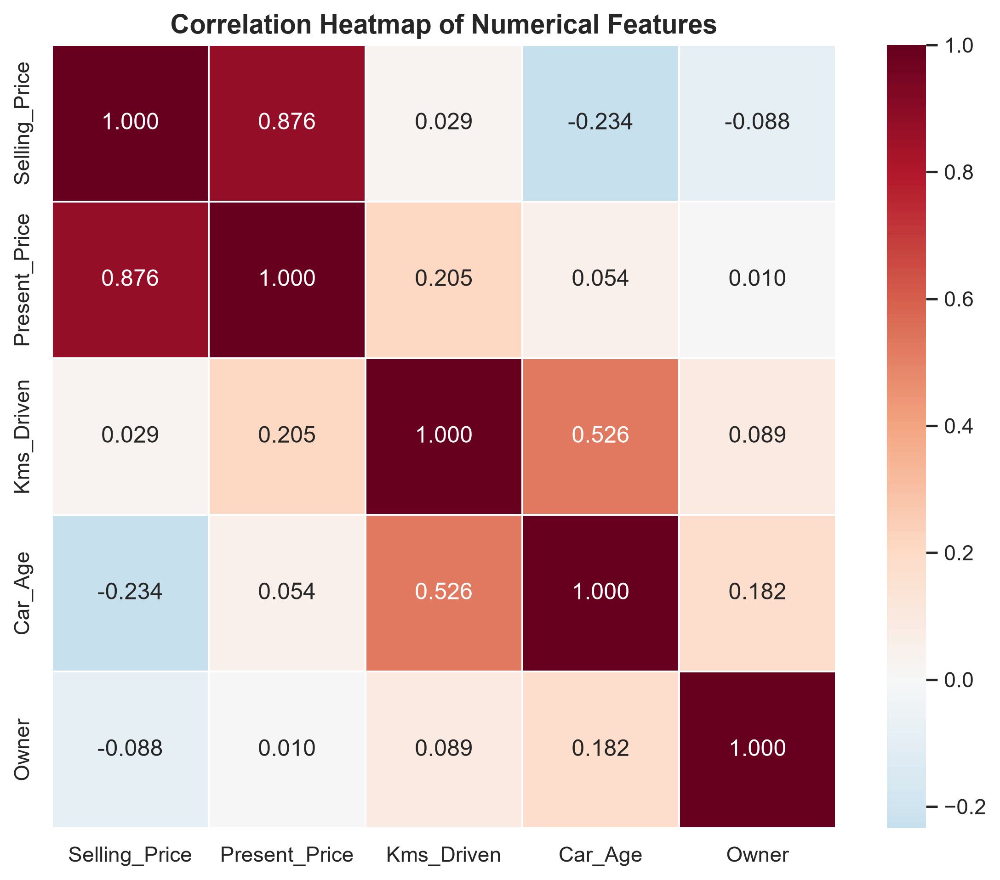
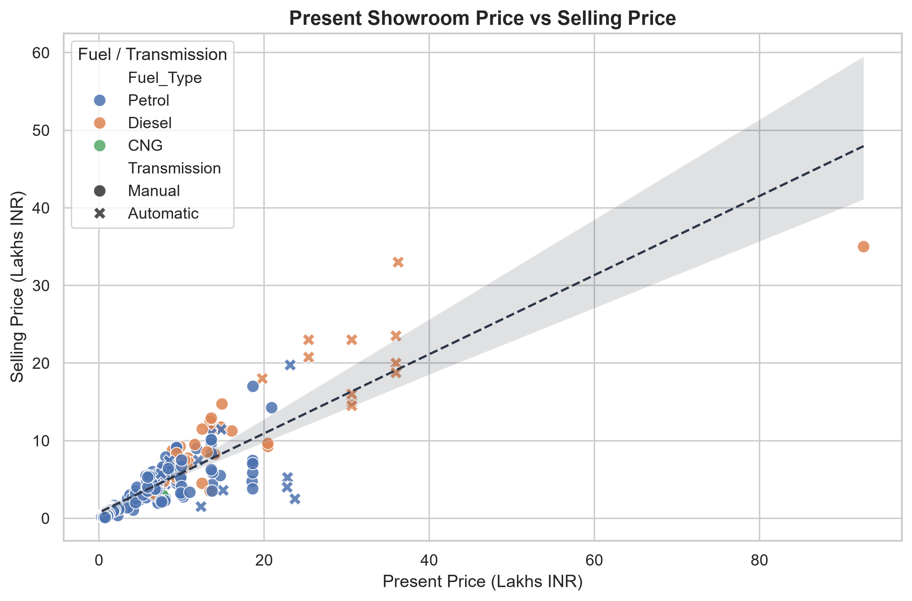
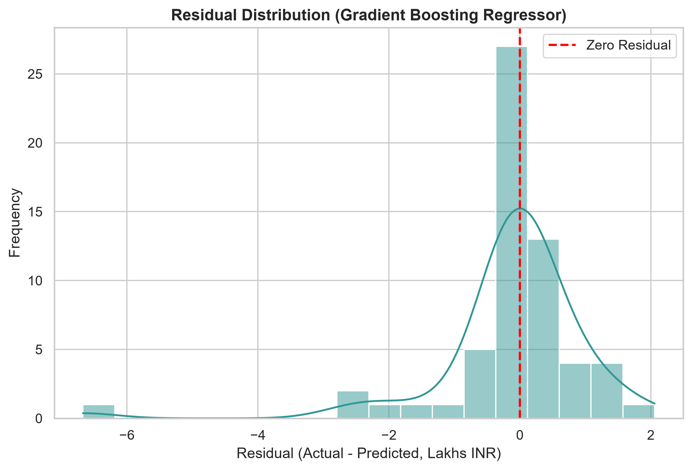

# Car Price Prediction Using Machine Learning

## CodeAlpha Data Science Internship – Task 3

### Project Overview
This project builds an end-to-end supervised machine learning pipeline to predict the resale selling price (`Selling_Price`, in Lakhs INR) of used vehicles using the **CarDekho Vehicle Dataset**. It covers data exploration, cleaning, leak-free `scikit-learn` preprocessing, feature engineering, exploratory data analysis, model benchmarking across five regression algorithms, residual diagnostics, model persistence with Joblib, and standalone CLI/API inference.

---

### Problem Statement
Given a vehicle's attributes—manufacturing year, current showroom price (`Present_Price`), kilometres driven (`Kms_Driven`), fuel type (`Fuel_Type`), seller type (`Seller_Type`), transmission type (`Transmission`), and prior ownership count (`Owner`)—accurately predict its used-market selling price (`Selling_Price`).

---

### Objectives
- Inspect and clean the CarDekho dataset (`car data.csv`), handling duplicates and validating domain constraints without discarding valid extreme observations.
- Prevent data leakage by fitting scaling (`StandardScaler`) and one-hot encoding (`OneHotEncoder`) exclusively on training folds via `scikit-learn` pipelines.
- Derive meaningful features (`Car_Age`) and visualize relationships across 10 EDA charts and 5 model evaluation charts.
- Train and compare five regression models using 5-fold cross-validation and an 80:20 stratified holdout split (`MAE`, `MSE`, `RMSE`, and `R² Score`).
- Save the best fitted pipeline (`models/best_car_price_model.joblib`) and enable reusable predictions without retraining.

---

### Dataset Source & Download Instructions
- **Dataset:** Vehicle Dataset from CarDekho (`car data.csv`)
- **Source:** [Kaggle – Vehicle Dataset from CarDekho](https://www.kaggle.com/datasets/nehalbirla/vehicle-dataset-from-cardekho)
- **Expected Columns:** `Car_Name`, `Year`, `Selling_Price`, `Present_Price`, `Kms_Driven`, `Fuel_Type`, `Seller_Type`, `Transmission`, `Owner`
- **Target Variable:** `Selling_Price` (in Lakhs INR)

#### Manual Download Instructions
If `dataset/car data.csv` is not already present locally (CSV files are excluded from Git via `.gitignore`):
1. Open the [Kaggle dataset page](https://www.kaggle.com/datasets/nehalbirla/vehicle-dataset-from-cardekho) and download the archive.
2. Extract `car data.csv` and place it at:
   ```text
   dataset/car data.csv
   ```
   *(Alternatively, download via `kagglehub.dataset_download("nehalbirla/vehicle-dataset-from-cardekho")` and copy `car data.csv` into `dataset/`.)*

---

### Technologies Used
- Python 3
- NumPy
- Pandas
- Matplotlib
- Seaborn
- Scikit-Learn
- Joblib
- Jupyter Notebook & IPyKernel

---

### Project Structure
```text
CodeAlpha_CarPricePrediction/
│
├── dataset/
│   └── car data.csv
│
├── notebooks/
│   └── car_price_prediction.ipynb
│
├── outputs/
│   ├── visualizations/
│   │   ├── 01_selling_price_distribution.png
│   │   ├── 02_present_price_vs_selling_price.png
│   │   ├── 03_car_age_vs_selling_price.png
│   │   ├── 04_kms_driven_vs_selling_price.png
│   │   ├── 05_fuel_type_vs_selling_price.png
│   │   ├── 06_transmission_vs_selling_price.png
│   │   ├── 07_seller_type_vs_selling_price.png
│   │   ├── 08_correlation_heatmap.png
│   │   ├── 09_categorical_boxplots.png
│   │   └── 10_feature_importance.png
│   ├── model_evaluation/
│   │   ├── actual_vs_predicted.png
│   │   ├── model_comparison.png
│   │   ├── model_metadata.json
│   │   ├── residual_distribution.png
│   │   ├── residuals_vs_predicted.png
│   │   └── selected_model_feature_importance.png
│   ├── model_comparison.csv
│   ├── prediction_results.csv
│   └── final_project_report.md
│
├── models/
│   └── best_car_price_model.joblib
│
├── src/
│   ├── __init__.py
│   ├── data_loader.py
│   ├── preprocessing.py
│   ├── train.py
│   ├── evaluate.py
│   └── predict.py
│
├── .gitignore
├── LICENSE
├── README.md
└── requirements.txt
```

---

### Installation Instructions
1. Navigate to the project directory:
   ```bash
   cd CodeAlpha_CarPricePrediction
   ```
2. Create and activate a virtual environment (optional, recommended):
   ```bash
   python -m venv venv
   # Windows:
   venv\Scripts\activate
   # Linux/macOS:
   source venv/bin/activate
   ```
3. Install dependencies:
   ```bash
   pip install -r requirements.txt
   ```

---

### How to Run

#### 1. Run the Jupyter Notebook
Launch Jupyter and execute `notebooks/car_price_prediction.ipynb`:
```bash
jupyter notebook notebooks/car_price_prediction.ipynb
```

#### 2. Train & Evaluate All Models via CLI
```bash
python -m src.train
```
This cleans the dataset (`301` raw rows -> `299` unique rows), trains all 5 models with 5-fold cross-validation, evaluates on the 20% holdout test split (`60` samples), exports CSV/JSON metrics and diagnostic plots, and saves the best pipeline to `models/best_car_price_model.joblib`.

#### 3. Make a Car Price Prediction
Run with the built-in realistic sample (`2017`, `Present_Price=9.85`, `Kms_Driven=6900`, `Petrol`, `Dealer`, `Manual`, `Owner=0`):
```bash
python -m src.predict
```
Or pass custom vehicle specifications:
```bash
python -m src.predict --year 2015 --present-price 30.61 --kms-driven 40000 --fuel-type Diesel --seller-type Dealer --transmission Automatic --owner 0
```

---

### Evaluation Metrics & Actual Model Results
All models were evaluated using 5-fold cross-validation (`239` train samples) and an 80:20 stratified holdout test set (`60` test samples) using **MAE**, **MSE**, **RMSE**, and **R² Score**:

| Model | CV R² Mean | Test MAE | Test MSE | Test RMSE | Test R² |
|---|---:|---:|---:|---:|---:|
| **Gradient Boosting Regressor** | **0.8590** | **0.6215** | **1.3932** | **1.1803** | **0.9072** |
| Extra Trees Regressor | 0.8629 | 0.5946 | 1.4470 | 1.2029 | 0.9036 |
| Linear Regression | 0.7798 | 1.1965 | 3.1208 | 1.7666 | 0.7921 |
| Random Forest Regressor | 0.8611 | 0.8382 | 3.7620 | 1.9396 | 0.7494 |
| Decision Tree Regressor | 0.8700 | 0.8728 | 4.6664 | 2.1602 | 0.6891 |

**Best Model Selected:** `Gradient Boosting Regressor` (`Test R² = 0.9072`, `RMSE = 1.1803` Lakhs INR, `MAE = 0.6215` Lakhs INR)

---

### Visualizations
Key exploratory and evaluation charts saved by the project:

| Model Comparison | Actual vs Predicted |
|---|---|
|  |  |

| Feature Importance | Correlation Heatmap |
|---|---|
|  |  |

| Present Price vs Selling Price | Residual Distribution |
|---|---|
|  |  |

---

### Conclusion
`Present_Price` (`0.8803` importance) and `Car_Age` (`0.0764` importance) are the primary determinants of used vehicle resale value in the CarDekho dataset. By combining leak-free preprocessing with `Gradient Boosting Regressor`, the pipeline achieves **90.72% R²** on unseen test data and provides fast, validated resale price estimates via `src/predict.py`.

---

### Author
**Vishnu Harikaran**  
CodeAlpha Data Science Internship – Task 3
